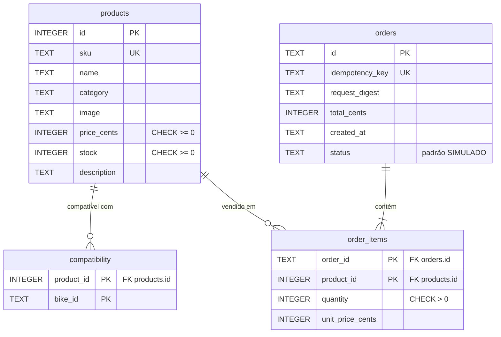
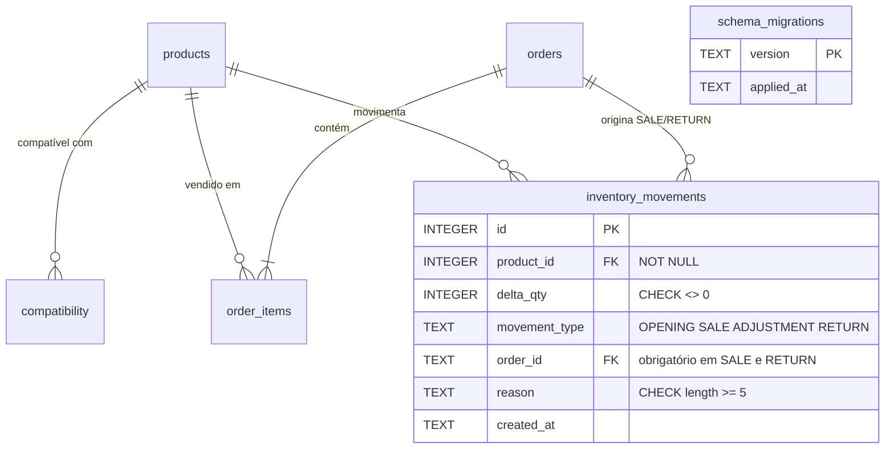

# DER — banco da Rota 2 Motopeças (SQLite, Opção A)

Gerado a partir de `app/db.py` (esquema atual) e `migrations/001_inventory_ledger.sql` (proposto/implementado).
Os diagramas usam Mermaid (renderizado pelo GitHub).

## DER atual (baseline: 4 tabelas)

## DER proposto e implementado (+ schema_migrations e inventory_movements)

As tabelas `products`, `compatibility`, `orders` e `order_items` não mudam.
`schema_migrations` não tem relação com as demais: só registra quais migrações foram aplicadas.

## O que a migração 001 acrescenta além das tabelas

| Objeto | Função |
|---|---|
| `ux_opening_product` (índice único parcial) | no máximo um saldo de abertura por produto |
| `ux_sale_order_product` (índice único parcial) | uma venda por par (pedido, produto) |
| `ix_movements_product`, `ix_compat_bike`, `ix_products_category` | consultas por produto, por moto e por categoria |
| `trg_inventory_movements_no_update` / `_no_delete` | ledger append-only |
